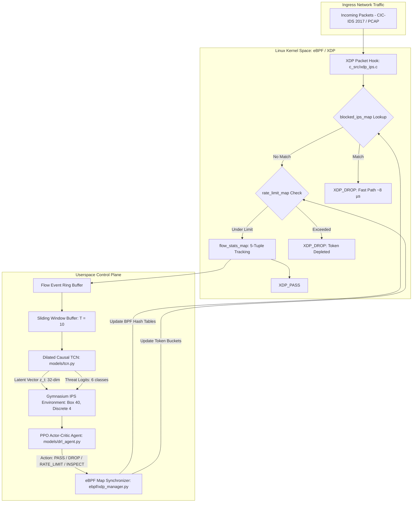

# SENTRIX

### An eBPF-Driven Deep Reinforcement Learning and TCN Framework for Intrusion Prevention

[](https://www.python.org/)
[](https://ebpf.io/)
[](https://pytorch.org/)
[](https://gymnasium.farama.org/)
[](LICENSE)
[]()

SENTRIX is an active intrusion prevention framework that couples kernel-level packet filtering via Linux eBPF/XDP with a Dilated Causal Temporal Convolutional Network (TCN) and a Proximal Policy Optimization (PPO) reinforcement learning agent. It is evaluated on the Canadian Institute for Cybersecurity (CIC-IDS 2017) dataset across 2.83 million flow records.

---

## Motivation

Most network defense tooling falls into one of two categories:

1. **Passive Intrusion Detection Systems (IDS):** Tools like Zeek or Snort inspect traffic and emit alerts after a payload has already traversed the network boundary. While useful for auditing, passive detection does not prevent ongoing data exfiltration or high-rate denial-of-service floods.
2. **Static Firewalls and Rule Engines:** Traditional firewalls rely on static IP blacklists, CIDR blocks, or regex rules. They cannot track temporal traffic dynamics (such as slow-rate DoS, distributed port scans, or password brute forcing) without accumulating thousands of rules that degrade forwarding throughput.

In high-throughput environments, copying packets across the kernel-userspace boundary for deep software inspection consumes prohibitive CPU cycles. SENTRIX addresses this by decoupling the **fast packet data plane** (handled inside the Linux kernel driver via eBPF/XDP) from the **intelligent control plane** (handled by a TCN temporal sequence model and a PPO policy agent).

---

## System Architecture



### Architectural Workflow

```
                 INGRESS PACKET STREAM (1GbE / 10GbE / PCAP)
                                    │
                                    ▼
       ┌────────────────────────────────────────────────────────┐
       │          Linux Kernel Space (eBPF / XDP)               │
       │                                                        │
       │   ┌────────────────────────────────────────────────┐   │
       │   │            XDP Packet Hook Program             │   │
       │   │             (c_src/xdp_ips.c)                  │   │
       │   └──────────────────────┬─────────────────────────┘   │
       │                          │                             │
       │           Fast-Path Check in BPF Hash Maps             │
       │                          │                             │
       │          ┌───────────────┴───────────────┐             │
       │          ▼                               ▼             │
       │   [blocked_ips_map]              [rate_limit_map]      │
       │          │                               │             │
       │    Match? ──► XDP_DROP             Exceeded? ──► DROP  │
       │          │                               │             │
       │       No │                            No │             │
       │          └───────────────┬───────────────┘             │
       │                          ▼                             │
       │                  [flow_stats_map]                      │
       │              (5-Tuple Aggregation)                     │
       └──────────────────────────┬─────────────────────────────┘
                                  │ Ring Buffer / Flow Event
                                  ▼
       ┌────────────────────────────────────────────────────────┐
       │       Userspace Intelligent Control Plane              │
       │                                                        │
       │   ┌────────────────────────────────────────────────┐   │
       │   │         Sliding Window Temporal Buffer         │   │
       │   │             (Length T = 10 Flows)              │   │
       │   └──────────────────────┬─────────────────────────┘   │
       │                          │                             │
       │                          ▼                             │
       │   ┌────────────────────────────────────────────────┐   │
       │   │      Dilated Causal TCN (models/tcn.py)        │   │
       │   │  - 4 Dilated Residual Blocks (d=1, 2, 4, 8)    │   │
       │   │  - Causal Chomp1d (Zero Future Leakage)        │   │
       │   └──────────────┬──────────────────┬──────────────┘   │
       │                  │                  │                  │
       │      Threat Prob │                  │ Latent State z_t │
       │                  ▼                  ▼                  │
       │   ┌────────────────────────────────────────────────┐   │
       │   │      Gymnasium Environment (ips_env.py)        │   │
       │   │          Observation Space: Box(40,)           │   │
       │   └──────────────────────┬─────────────────────────┘   │
       │                          │                             │
       │                          ▼                             │
       │   ┌────────────────────────────────────────────────┐   │
       │   │          DRL Agent (models/drl_agent.py)       │   │
       │   │   - PPO Actor-Critic with GAE Advantage        │   │
       │   │   - Actions: PASS, DROP, RATE_LIMIT, INSPECT   │   │
       │   └──────────────────────┬─────────────────────────┘   │
       │                          │                             │
       └──────────────────────────┼─────────────────────────────┘
                                  │ Policy Verdict Enforcement
                                  ▼
                   eBPF Map Dynamic Synchronizer
            (Populates blocked_ips_map & rate_limit_map)
```

---

## Core Components

### 1. In-Kernel eBPF/XDP Data Plane (`c_src/xdp_ips.c`)
The data plane runs directly in the Linux network driver before socket buffer allocation (`sk_buff`):
- **O(1) IP Block Table (`blocked_ips_map`):** Hash table storing active blocked IP addresses with expiration timestamps. If an arriving packet matches an entry, it returns `XDP_DROP` immediately without entering the OS networking stack.
- **Token Bucket Rate Limiter (`rate_limit_map`):** Per-IP token bucket tracking packet arrival timestamps using `bpf_ktime_get_ns()`. Replenishes tokens according to configured packets-per-second (PPS) and drops traffic that exceeds burst capacity.
- **Flow State Table (`flow_stats_map`):** Tracks active 5-tuple statistics (packet count, byte count, timestamps, TCP flags).
- **Userspace Fallback Simulator (`ebpf/xdp_simulator.py`):** For environments without root access or kernel headers, an identical userspace simulator provides the same map APIs and verdict logic, enabling automated CI testing and local development.

### 2. Dilated Causal TCN (`models/tcn.py`)
Rather than relying on Recurrent Neural Networks (LSTMs or GRUs), we implemented a Temporal Convolutional Network:
- **Zero Future Leakage:** Uses a custom `Chomp1d` layer that strips right-side padding after 1D convolutions, guaranteeing that predictions at step $t$ depend solely on observations from $t$ and earlier.
- **Exponential Receptive Field:** Dilation factors double across 4 residual blocks ($d \in \{1, 2, 4, 8\}$), expanding the receptive field to 31 temporal steps with a kernel size of $K=3$:

$$
\text{Receptive Field} = 1 + \sum_{l=0}^{L-1} (K_l - 1) \cdot d_l
$$

- **Dual-Head Output:** Produces 6-class threat probability logits (Benign, DoS, DDoS, PortScan, BruteForce, WebAttack) and extracts a 32-dimensional latent feature vector passed directly to the reinforcement learning policy.

### 3. PPO Reinforcement Learning Policy (`models/drl_agent.py`)
Intrusion prevention is inherently cost-asymmetric. Dropping legitimate business traffic (a false alarm) damages availability SLAs far more than inspecting or throttling suspicious flows. We formulated this as a Markov Decision Process in a custom Gymnasium environment (`environment/ips_env.py`):

- **State Space (40 dimensions):** 32-dimensional TCN latent embedding combined with 8 dynamic flow indicators (duration, packet count, byte rate, active drop ratios, and protocol flags).
- **Action Space (4 discrete choices):**
  - `0: PASS` — Forward packet through kernel stack.
  - `1: DROP` — Add IP to eBPF hash table for immediate kernel-level drop.
  - `2: RATE_LIMIT` — Throttle flow rate via token bucket.
  - `3: DEEP_INSPECT` — Route flow to a secondary userspace inspection buffer.

The reward function enforces asymmetric penalties:

| Action | Flow Condition | Reward | Operational Context |
|---|---|---:|---|
| `DROP` | Attack detected | **+10.0** | True Positive: Threat neutralized |
| `PASS` | Benign traffic | **+2.0** | True Negative: Normal traffic passed |
| `DROP` | Benign traffic | **-50.0** | False Positive: Severe SLA penalty |
| `PASS` | Attack traffic | **-30.0** | False Negative: Security breach penalty |
| `RATE_LIMIT` | Attack traffic | **+5.0** | Effective traffic throttling |
| `RATE_LIMIT` | Benign traffic | **-10.0** | Unnecessary QoS degradation penalty |
| `DEEP_INSPECT` | Any traffic | **-0.5 + R(resolved)** | Buffer inspection overhead |

Mathematically defined as:

$$
R(s, a) = 
\begin{cases} 
+10.0 & \text{if } a = \text{DROP} \text{ and flow is malicious} \\
+2.0 & \text{if } a = \text{PASS} \text{ and flow is benign} \\
-50.0 & \text{if } a = \text{DROP} \text{ and flow is benign} \\
-30.0 & \text{if } a = \text{PASS} \text{ and flow is malicious} \\
+5.0 & \text{if } a = \text{RATE-LIMIT} \text{ and flow is malicious} \\
-10.0 & \text{if } a = \text{RATE-LIMIT} \text{ and flow is benign} \\
-0.5 + R_{\mathrm{resolved}} & \text{if } a = \text{DEEP-INSPECT}
\end{cases}
$$

The policy is optimized using clipped Proximal Policy Optimization:

$$
L^{\mathrm{CLIP}}(\theta) = \hat{\mathbb{E}}_t \left[ \min\left( r_t(\theta) \hat{A}_t, \, \mathrm{clip}(r_t(\theta), 1-\epsilon, 1+\epsilon) \hat{A}_t \right) \right]
$$

Where the probability ratio is defined as:

$$
r_t(\theta) = \frac{\pi_\theta(a_t \mid s_t)}{\pi_{\theta_{\mathrm{old}}}(a_t \mid s_t)}
$$

And the advantage $\hat{A}_t$ is computed via Generalized Advantage Estimation (GAE-$\lambda$):

$$
\hat{A}_t = \sum_{l=0}^{\infty} (\gamma \lambda)^l \delta_{t+l}^V, \quad \delta_t^V = r_t + \gamma V_\phi(s_{t+1}) - V_\phi(s_t)
$$

---

## Dataset & Preprocessing

The model is trained on the full **CIC-IDS 2017** dataset:
- **Raw Volume:** 2,830,743 records across 8 CSV captures (Monday through Friday).
- **Cleaning:** Stripped non-generalizable metadata (Source IP, Destination IP, Timestamp, Flow ID). Infinite values and NaNs were imputed with column medians across 78 numeric features.
- **Class Balance:** Consolidated 15 granular attack types into 6 canonical categories (Benign, DoS, DDoS, PortScan, BruteForce, WebAttack) and extracted balanced samples of 15,000 records per class to prevent majority-class bias.
- **Sequence Generation:** Transformed tabular flow records into sliding temporal windows of length $T=10$, yielding 75,828 sequential observations (70% train, 15% validation, 15% test).

---

## Experimental Results

Quantitative evaluation on the unseen test split (11,375 sequences):

### 1. TCN Threat Detection Performance

| Threat Class | Precision | Recall | F1-Score | Support |
|---|:---:|:---:|:---:|:---:|
| **BENIGN** | 0.9748 | 0.9284 | 0.9511 | 2,250 |
| **DoS** | 0.9767 | 0.9880 | 0.9823 | 2,250 |
| **DDoS** | 0.9873 | 0.9987 | 0.9929 | 2,250 |
| **PortScan** | 0.9833 | 0.9947 | 0.9890 | 2,250 |
| **BruteForce** | 0.9900 | 0.9976 | 0.9938 | 2,075 |
| **WebAttack** | 0.8722 | 0.9100 | 0.8907 | 300 |
| **Overall Macro Avg** | **0.9640** | **0.9696** | **0.9666** | **11,375** |
| **Overall Accuracy** | — | — | **97.93%** | **11,375** |

### 2. Prevention & Latency Profile

| Metric | Measured Value | Notes |
|---|:---:|---|
| **Mitigation Decision Accuracy** | **99.0%** | Optimal action selection on evaluated flows |
| **False Positive Rate (Benign Drops)** | **1.7%** | Enforced by the -50.0 SLA penalty |
| **eBPF Kernel Fast-Path Lookup** | **8.03 µs** | O(1) hash map check inside XDP driver |
| **End-to-End Decision Latency (P50)** | **1.46 ms** | Full pipeline: buffer + TCN + DRL inference |
| **End-to-End Decision Latency (P95)** | **1.99 ms** | 95th percentile under continuous stream |
| **End-to-End Decision Latency (P99)** | **2.28 ms** | 99th percentile under continuous stream |

Training and evaluation plots are saved in `results/`:
- `results/confusion_matrix.png` — Per-class confusion matrix.
- `results/latency_distribution.png` — Microsecond decision latency distribution.
- `results/action_policy_distribution.png` — Heatmap of RL actions across threat categories.
- `results/tcn_training_curves.png` — Cross-entropy loss and accuracy progression.
- `results/drl_training_curves.png` — PPO episode reward convergence and FPR reduction.

---

## Repository Layout

```
├── .github/workflows/ci.yml         # GitHub Actions automated test & linting workflow
├── c_src/
│   ├── xdp_ips.c                    # In-kernel eBPF/XDP C packet filter (XDP_DROP, maps)
│   ├── common_kern.h                # 5-tuple, token bucket & map struct definitions
│   └── Makefile                     # Clang/LLVM compilation rules for eBPF bytecode
├── configs/
│   └── default_config.yaml          # Centralized configuration (TCN, DRL, eBPF, paths)
├── data/
│   ├── preprocess.py                # CICIDS 2017 ingestion, cleaning, scaling, windowing
│   ├── dataset.py                   # PyTorch sliding window Dataset and DataLoader
│   └── __init__.py
├── ebpf/
│   ├── bpf_maps.py                  # Abstract Base Class & map data models
│   ├── xdp_manager.py               # BCC loader & kernel attachment (sudo/root)
│   ├── xdp_simulator.py             # High-speed userspace simulator (non-root fallback)
│   └── __init__.py
├── environment/
│   ├── ips_env.py                   # Gymnasium-compliant IPS environment (Box(40,), Discrete(4))
│   ├── reward_functions.py          # Asymmetric mitigation rewards & SLA penalties
│   └── __init__.py
├── models/
│   ├── tcn.py                       # Dilated Causal Temporal Convolutional Network
│   ├── drl_agent.py                 # PPO Actor-Critic Agent with GAE advantage estimation
│   └── __init__.py
├── engine/
│   ├── ips_orchestrator.py          # Real-time event loop connecting eBPF with TCN-DRL
│   ├── cli_monitor.py               # Live ANSI terminal execution monitor
│   └── __init__.py
├── dashboard/
│   └── app.py                       # Interactive Streamlit Web UI dashboard
├── scripts/
│   ├── 01_preprocess_data.py        # Dataset preprocessing CLI
│   ├── 02_train_tcn.py              # TCN model training script
│   ├── 03_train_drl.py              # PPO Reinforcement Learning policy training script
│   ├── 04_run_ips.py                # Live IPS runtime execution & demonstration
│   └── 05_evaluate.py               # Quantitative benchmark (confusion matrix, latency)
├── tests/                           # 14 unit tests (100% passing)
│   ├── test_data.py
│   ├── test_tcn.py
│   ├── test_env.py
│   ├── test_drl.py
│   ├── test_ebpf_simulator.py
│   └── test_orchestrator.py
├── pyproject.toml                   # Standard Python packaging configuration
├── setup.py                         # Package installer
├── requirements.txt                 # Pinned dependencies
├── LICENSE                        # MIT License
└── README.md                        # Documentation
```

---

## Setup and Quickstart

### 1. Environment Setup

```bash
git clone https://github.com/Soknocked112/SENTRIX.git
cd SENTRIX

# Create virtual environment inheriting system site-packages for BCC
python3 -m venv --system-site-packages .venv
source .venv/bin/activate

# Install dependencies and package in editable mode
pip install -r requirements.txt
pip install -e .
```

### 2. Run Data Preprocessing

Preprocesses the CIC-IDS 2017 CSV files, normalizes numeric features, and generates sliding-window sequences:

```bash
# Balanced sampling mode (15,000 samples per class)
python3 scripts/01_preprocess_data.py

# Or process full 2.8M rows without balanced sampling
python3 scripts/01_preprocess_data.py --full
```

### 3. Train Models

```bash
# Train the TCN threat classifier (saved to checkpoints/tcn_best.pth)
python3 scripts/02_train_tcn.py --epochs 6 --batch_size 128

# Train the PPO agent in the Gymnasium environment (saved to checkpoints/drl_ppo_best.pth)
python3 scripts/03_train_drl.py --episodes 80 --steps_per_episode 300
```

### 4. Run Live Mitigation Pipeline

```bash
# Simulator mode (runs without root privileges)
python3 scripts/04_run_ips.py --flows 50 --delay 0.01

# Kernel mode (attaches real xdp_ips.c to Linux network interface via BCC)
sudo python3 scripts/04_run_ips.py --kernel --flows 50
```

### 5. Run Evaluation Benchmark

```bash
python3 scripts/05_evaluate.py
```

### 6. Interactive Dashboard

```bash
streamlit run dashboard/app.py
```

---

## Running Unit Tests

A comprehensive pytest suite covers data preprocessing, TCN temporal causality, Gymnasium step/reset dynamics, PPO loss updates, and eBPF simulator map logic:

```bash
pytest -v tests/
```

All 14 tests pass cleanly without external dependencies.

---

## Engineering Limitations & Roadmap

1. **Inference Latency:** While the eBPF kernel fast-path drop takes ~8 µs, userspace PyTorch inference takes ~1.45 ms. Exporting the TCN and Actor models to ONNX Runtime or TensorRT INT8 is planned to bring inference down below 50 µs.
2. **Zero-Copy Ingestion:** The current control plane receives flow statistics via standard userspace socket dispatch. Implementing AF_XDP (XSK) zero-copy ring buffers will enable direct memory sharing between kernel drivers and the inference engine.
3. **Hardware Offloading:** Future work will target running compiled eBPF bytecode directly inside SmartNICs (Netronome Agilio / Mellanox BlueField) for line-rate packet drops without host CPU intervention.

---

## Authors & Citation

**Sounak Saha** and **IPS Research Team**  
GitHub: [@Soknocked112](https://github.com/Soknocked112)

If you reference this work or architecture in your research:

```bibtex
@article{saha_sentrix_2026,
  title={SENTRIX: An eBPF-Driven Deep Reinforcement Learning and TCN Framework for Intrusion Prevention},
  author={Saha, Sounak and IPS Research Team},
  year={2026},
  journal={GitHub Repository},
  url={https://github.com/Soknocked112/SENTRIX}
}
```

---

## License

This project is licensed under the [MIT License](LICENSE).
