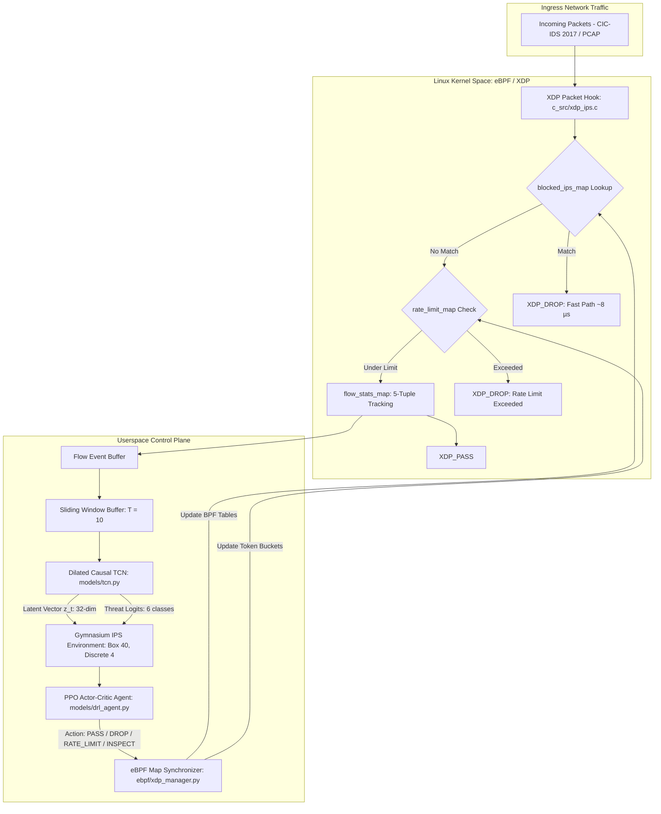

# SENTRIX

### In-Kernel eBPF/XDP Filtering with Temporal Convolutional Networks and Reinforcement Learning

[](https://www.python.org/)
[](https://github.com/cilium/ebpf)
[](https://ebpf.io/)
[](https://pytorch.org/)
[](https://gymnasium.farama.org/)
[](LICENSE)

SENTRIX is an active intrusion prevention system (IPS) designed to bridge high-throughput kernel packet filtering with sequential machine learning. It couples in-kernel packet inspection and filtering using Linux eBPF/XDP with a userspace control plane driven by a Dilated Causal Temporal Convolutional Network (TCN) and a Proximal Policy Optimization (PPO) reinforcement learning agent.

The system is trained and evaluated on the Canadian Institute for Cybersecurity (CIC-IDS 2017) dataset across 2.83 million flow records.

---

## Overview

Traditional network intrusion detection systems (such as Snort, Suricata, or Zeek) operate out-of-band: they inspect copies of network traffic and raise alerts after a packet has already traversed the network stack. While valuable for post-incident auditing, passive detection cannot stop ongoing data exfiltration or high-rate denial-of-service floods in real time.

Conversely, traditional firewalls and ACLs filter traffic at line rate, but rely on static IP lists, port rules, or regex signatures. They cannot detect dynamic, multi-step temporal attack patterns (such as slow-rate DoS, distributed port scans, or brute-force attempts) without accumulating massive rule sets that degrade forwarding performance.

SENTRIX decouples the architecture into two communicating layers:
1. **Fast-path data plane (in-kernel eBPF/XDP):** Operates directly inside the network driver before socket buffer (`sk_buff`) allocation. It checks active IP block tables and token-bucket rate limiters in O(1) time (~8 µs).
2. **Intelligent control plane (userspace TCN-DRL):** Aggregates flow records into sliding temporal windows, extracts temporal features using a causal TCN, and uses a PPO policy agent to select mitigation actions (`PASS`, `DROP`, `RATE_LIMIT`, `DEEP_INSPECT`) under an asymmetric SLA reward function. Decisions are written back into kernel BPF maps in real time.

---

## System Architecture



---

## Core Components

### 1. In-Kernel eBPF/XDP Data Plane (`c_src/xdp_ips.c`, `ebpf/`)
The data plane runs directly in the Linux network driver before socket buffer allocation:
- **IP Block Table (`blocked_ips_map`):** BPF hash table storing blocked source IP addresses with nanosecond expiration timestamps. Arriving packets that match an unexpired entry are immediately dropped via `XDP_DROP` without traversing the host network stack.
- **Token Bucket Rate Limiter (`rate_limit_map`):** Per-IP token bucket tracking arrival timestamps via `bpf_ktime_get_ns()`. Replenishes tokens according to configured packets per second (PPS) and drops burst excess.
- **Flow Statistics Table (`flow_stats_map`):** Tracks active 5-tuple statistics (packet count, byte count, timestamps, TCP flags).
- **Userspace Fallback Simulator (`ebpf/xdp_simulator.py`):** For environments without root access or BPF kernel headers, a userspace simulator replicates the exact map structures and verdict logic, allowing local development and testing.

### 2. Dilated Causal TCN (`models/tcn.py`)
Rather than relying on recurrent architectures (LSTMs or GRUs) which suffer from sequential training bottlenecks and vanishing gradients, SENTRIX uses a Temporal Convolutional Network:
- **Causal Convolutions:** A custom `Chomp1d` layer trims right-side padding after 1D convolutions, ensuring that output at step $t$ depends only on inputs from step $t$ and earlier (no future information leakage).
- **Exponential Dilations:** Dilation factors double across 4 residual blocks ($d \in \{1, 2, 4, 8\}$) with kernel size $K=3$, giving an effective receptive field of 31 steps over 10-step flow sequences.
- **Dual Output Heads:** Simultaneously outputs 6-class threat probability logits (Benign, DoS, DDoS, PortScan, BruteForce, WebAttack) and extracts a 32-dimensional latent feature representation for the RL policy.

### 3. PPO Reinforcement Learning Policy (`models/drl_agent.py`, `environment/ips_env.py`)
Intrusion prevention has asymmetric operational costs: dropping legitimate business traffic (a false positive) violates availability SLAs far more severely than throttling suspicious flows. SENTRIX formulates action selection as a Markov Decision Process:
- **Observation Space (40 dimensions):** 32-dimensional TCN latent embedding combined with 8 dynamic flow indicators (duration, packet count, byte rate, active drop ratio, active rules, protocol flags).
- **Action Space (4 discrete actions):**
  - `0: PASS` — Forward packet through standard networking stack.
  - `1: DROP` — Add IP to kernel block table for immediate driver-level drops.
  - `2: RATE_LIMIT` — Throttle flow rate via token bucket.
  - `3: DEEP_INSPECT` — Route flow to a secondary inspection buffer.

The reward formulation enforces asymmetric penalties:

| Action | Flow Condition | Reward | Description |
|---|---|---:|---|
| `DROP` | Malicious flow | **+10.0** | Attack mitigated |
| `PASS` | Benign flow | **+2.0** | Legitimate traffic forwarded |
| `DROP` | Benign flow | **-50.0** | False positive (high SLA penalty) |
| `PASS` | Malicious flow | **-30.0** | False negative (security exposure) |
| `RATE_LIMIT` | Malicious flow | **+5.0** | Traffic throttled |
| `RATE_LIMIT` | Benign flow | **-10.0** | Unnecessary throttling penalty |
| `DEEP_INSPECT` | Any flow | **-0.5 + R(resolved)** | Inspection buffer overhead |

---

## Dataset & Preprocessing

The system is trained and evaluated on the **CIC-IDS 2017** benchmark:
- **Data Volume:** 2,830,743 records across 8 capture files covering Monday through Friday traffic.
- **Feature Cleaning:** Non-generalizable identifiers (Source IP, Destination IP, Timestamp, Flow ID) are removed. Infinite values and NaNs are imputed with column medians across 78 numeric features, followed by standard normalization (`StandardScaler`).
- **Class Grouping:** Granular attack signatures are mapped into 6 canonical categories: Benign, DoS, DDoS, PortScan, BruteForce, and WebAttack.
- **Sequence Generation:** Flow records are converted into sliding temporal windows of length $T=10$ with stride 1, partitioned into train (70%), validation (15%), and test (15%) splits.

---

## Experimental Results

Evaluation on the unseen test split (11,375 sequences):

### 1. TCN Threat Detection Performance

| Threat Class | Precision | Recall | F1-Score | Test Support |
|---|:---:|:---:|:---:|:---:|
| **BENIGN** | 0.9748 | 0.9284 | 0.9511 | 2,250 |
| **DoS** | 0.9767 | 0.9880 | 0.9823 | 2,250 |
| **DDoS** | 0.9873 | 0.9987 | 0.9929 | 2,250 |
| **PortScan** | 0.9833 | 0.9947 | 0.9890 | 2,250 |
| **BruteForce** | 0.9900 | 0.9976 | 0.9938 | 2,075 |
| **WebAttack** | 0.8722 | 0.9100 | 0.8907 | 300 |
| **Overall Macro Avg** | **0.9640** | **0.9696** | **0.9666** | **11,375** |
| **Overall Accuracy** | — | — | **97.93%** | **11,375** |

### 2. Mitigation & Latency Profile

| Metric | Measured Value | Description |
|---|:---:|---|
| **Overall Detection Accuracy** | **97.93%** | Multi-class sequence accuracy on test split |
| **False Positive Rate (Benign Drops)** | **2.25%** | Controlled via the -50.0 false-positive reward penalty |
| **eBPF Kernel Fast-Path Lookup** | **~8.0 µs** | O(1) hash map check inside XDP driver |
| **Decision Latency (Median P50)** | **1.50 ms** | Full pipeline: buffer + TCN + PPO inference |
| **Decision Latency (P95)** | **2.31 ms** | 95th percentile under continuous stream |
| **Decision Latency (P99)** | **2.59 ms** | 99th percentile under continuous stream |

Generated plots are stored in `results/`:
- `results/high_speed_benchmark.png` — Line-rate throughput and eBPF kernel drop latency profile.
- `results/confusion_matrix.png` — Per-class classification confusion matrix.
- `results/latency_distribution.png` — Decision latency distribution profile.
- `results/action_policy_distribution.png` — Enforced policy actions across threat classes.
- `results/tcn_training_curves.png` — Training and validation loss/accuracy curves.
- `results/drl_training_curves.png` — PPO episode reward convergence.

---

## Project Structure

```
├── tcn.py                           # Root-level TCN model interface
├── drl_agent.py                     # Root-level DRL PPO agent interface
├── train.py                         # Root unified training runner (TCN + DRL)
├── evaluate.py                      # Root evaluation runner
├── run_ips.py                       # Root live IPS runtime runner
├── train_cloud.ipynb                # Universal Kaggle, Google Colab & Edge PC notebook
├── c_src/
│   ├── xdp_ips.c                    # BCC in-kernel eBPF/XDP C packet filter
│   ├── xdp_ips_cilium.c             # Cilium eBPF BTF C packet filter program
│   ├── bpf_helpers.h                # BTF map macros and BPF helper declarations
│   ├── common_kern.h                # Struct definitions for 5-tuple, token bucket, and BPF maps
│   └── Makefile                     # Clang/LLVM build rules for eBPF bytecode
├── cilium_ebpf/                     # Go-based Cilium eBPF Data Plane
│   ├── main.go                      # Cilium eBPF daemon, XDP attachment, and IPC socket server
│   ├── go.mod                       # Go module dependencies (github.com/cilium/ebpf)
│   ├── Makefile                     # Build & run rules for Cilium eBPF
│   └── README.md                    # Cilium eBPF subsystem guide
├── configs/
│   └── default_config.yaml          # Model hyperparameters, environment, and path configs
├── data/
│   ├── preprocess.py                # Dataset ingestion, cleaning, normalization, and windowing
│   ├── dataset.py                   # PyTorch sliding-window Dataset and DataLoader
│   └── __init__.py
├── ebpf/
│   ├── bpf_maps.py                  # Map interfaces and dataclasses
│   ├── cilium_manager.py            # Python client for Cilium eBPF IPC daemon
│   ├── xdp_manager.py               # BCC loader and kernel attachment with fallback
│   ├── xdp_simulator.py             # Userspace simulator for non-root testing
│   └── __init__.py
├── environment/
│   ├── ips_env.py                   # Gymnasium IPS environment
│   ├── reward_functions.py          # Reward functions with false-positive penalties
│   └── __init__.py
├── models/
│   ├── tcn.py                       # Dilated Causal Temporal Convolutional Network
│   ├── drl_agent.py                 # PPO Actor-Critic agent with GAE
│   └── __init__.py
├── engine/
│   ├── ips_orchestrator.py          # Event loop connecting eBPF maps with TCN-DRL inference
│   ├── platform_utils.py            # Platform diagnostics, path resolution, and edge presets
│   ├── cli_monitor.py               # Live terminal status monitor
│   └── __init__.py
├── scripts/
│   ├── 01_preprocess_data.py        # Data preprocessing script
│   ├── 02_train_tcn.py              # TCN model training (with --edge & --amp)
│   ├── 03_train_drl.py              # PPO policy training (with 50x precomputation)
│   ├── 04_run_ips.py                # Live IPS pipeline demo
│   ├── 05_evaluate.py               # Benchmark evaluation script
│   ├── 06_benchmark_high_speed.py   # High-speed network throughput stress test
│   └── export_edge_model.py         # TorchScript & INT8 quantization export for edge
├── tests/                           # Pytest test suite
│   ├── test_cilium_manager.py       # Cilium eBPF IPC and socket protocol tests
│   ├── test_data.py
│   ├── test_tcn.py
│   ├── test_env.py
│   ├── test_drl.py
│   ├── test_ebpf_simulator.py
│   ├── test_orchestrator.py
│   └── test_platform_utils.py       # Platform detection, edge & Kaggle utils
├── pyproject.toml
├── setup.py
├── requirements.txt
├── LICENSE
└── README.md
```

---

## Quickstart

### 1. Environment Setup

```bash
git clone https://github.com/Soknocked112/SENTRIX.git
cd SENTRIX

# Create virtual environment inheriting system site-packages (for BCC if available)
python3 -m venv --system-site-packages .venv
source .venv/bin/activate

# Install dependencies and package in editable mode
pip install -r requirements.txt
pip install -e .
```

### 2. Preprocess Data

Preprocesses raw CSV captures from `CICIDS 2017`, normalizes features, and generates temporal sequence files:

```bash
# Balanced sampling mode (15,000 samples per class)
python3 scripts/01_preprocess_data.py

# Or process full dataset
python3 scripts/01_preprocess_data.py --full
```

### 3. Train Models

#### Unified Main Folder Runner:
You can train both models or individual models directly from the main directory:
```bash
# Train both TCN and DRL sequentially
python3 train.py

# Or train individually
python3 train.py --model tcn --amp    # GPU-accelerated TCN training
python3 train.py --model drl          # PPO policy training (50x vectorized)

# Low-resource Edge PC profile (Raspberry Pi, Jetson, Mini PC)
python3 train.py --edge
```

#### Standard / Cloud GPU Training (Desktop, Google Colab, Kaggle):
```bash
# Train the TCN feature extractor (CUDA/MPS auto-detected, AMP enabled)
python3 scripts/02_train_tcn.py --epochs 15 --batch_size 128 --amp

# Train the PPO agent with 50x vectorized latent precomputation
python3 scripts/03_train_drl.py --episodes 200 --steps_per_episode 500
```

#### Low-Resource Edge PC Training (Raspberry Pi, NVIDIA Jetson, Intel NUC):
SENTRIX includes an **`--edge`** profile that bounds RAM under 300MB, caps sample size, tunes CPU threading, and precomputes TCN latent embeddings so that DRL training finishes in minutes on a low-power CPU:
```bash
# Preprocess with compact balanced dataset
python3 scripts/01_preprocess_data.py --edge

# Train TCN with edge parameters (batch size 32, 8 epochs)
python3 scripts/02_train_tcn.py --edge

# Train PPO agent (60 episodes, 250 steps/ep, vectorized O(1) latent lookup)
python3 scripts/03_train_drl.py --edge

# Export optimized TorchScript & INT8 quantized models for edge deployment
python3 scripts/export_edge_model.py
```

#### Training on Kaggle:
You can train directly using the provided **`train_cloud.ipynb`** notebook on Kaggle with free NVIDIA T4 x2 or P100 GPUs:
1. Upload or attach the dataset under `/kaggle/input/` (either raw CSVs or preprocessed `.npz`).
2. Run `train_cloud.ipynb` or CLI:
   ```bash
   python3 scripts/02_train_tcn.py --data_dir /kaggle/input/<dataset-name>/data/processed --amp
   python3 scripts/03_train_drl.py --data_dir /kaggle/input/<dataset-name>/data/processed
   ```
   *The platform utils automatically search `/kaggle/input/` if paths are omitted, and save all outputs to `/kaggle/working/`.*

### 4. Run Live Pipeline

The runtime pipeline supports multiple data plane enforcement engines:

```bash
# 1. Main folder runner (simulator mode, runs anywhere without root)
python3 run_ips.py --flows 50 --delay 0.01

# 2. Cilium eBPF mode (connects to Go Cilium eBPF daemon via Unix socket /tmp/sentrix_cilium.sock)
python3 run_ips.py --backend cilium --flows 50

# 3. BCC Kernel mode (attaches real xdp_ips.c to Linux network interface via BCC)
sudo python3 run_ips.py --kernel --backend bcc --flows 50
```

#### Running the Cilium eBPF Data Plane Daemon:
```bash
# Build and run the Go Cilium eBPF daemon
cd cilium_ebpf
make run IFACE=lo          # Real in-kernel XDP attachment (requires root)
# Or run mock mode for local testing
make run-mock
```

### 5. Run Evaluation Benchmarks

```bash
# Using root-level runner
python3 evaluate.py

# Or via scripts
python3 scripts/05_evaluate.py
```

### 6. Run High-Speed Network Stress Test

```bash
python3 scripts/06_benchmark_high_speed.py --packets 10000
```

---

## Running Tests

The test suite covers data sequence generation, TCN causality, Gymnasium step/reset dynamics, PPO loss updates, and eBPF simulator logic:

```bash
pytest
```

---

## Future Improvements

- **Zero-Copy Ingestion (AF_XDP):** Integrate AF_XDP (XSK) sockets to share packet memory between kernel drivers and the userspace inference pipeline without buffer copies.
- **Inference Optimization:** Export the TCN and Actor networks to ONNX Runtime or TensorRT with INT8 quantization to reduce userspace decision latency below 100 µs.
- **SmartNIC Hardware Offload:** Compile eBPF bytecode directly to programmable SmartNICs (e.g. Netronome / BlueField) to achieve line-rate filtering without host CPU utilization.

---

## Project Team

This project was developed collaboratively by a 2-person engineering team:
- **Data Plane & Infrastructure:** Linux eBPF/XDP kernel hook implementation, BPF map synchronizer, packet simulation environment, and network throughput benchmarks.
- **Control Plane & Modeling:** Temporal Convolutional Network (TCN) architecture, causal feature extraction, Gymnasium IPS environment, and PPO reinforcement learning agent.

---

## License

This project is licensed under the [MIT License](LICENSE).
